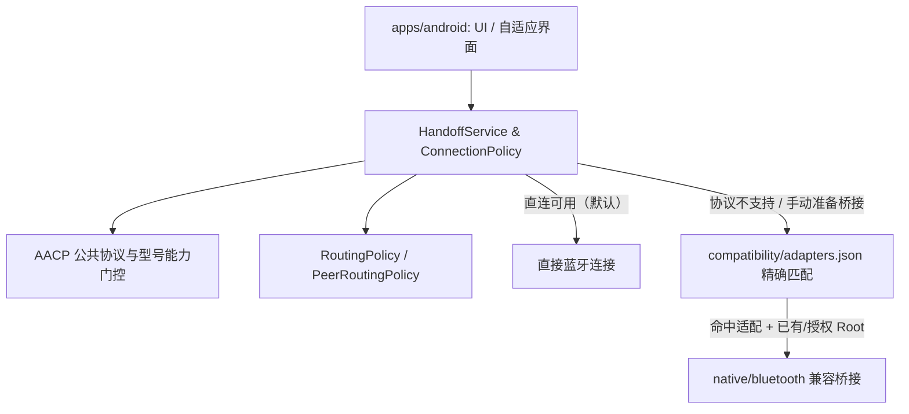

# Architecture

本文说明 LinkPods 当前源码的模块职责、依赖边界与核心数据流。可见行为与验收边界见 [SPEC.md](SPEC.md)，领域术语见 [GLOSSARY.md](GLOSSARY.md)，维护约束见 [AGENTS.md](AGENTS.md)，架构决策记录见 `docs/adr/`。

## 1. 模块与目录边界

| 路径 | 职责与边界 |
| --- | --- |
| `apps/android` | Android 主应用源码、原生控件、UI 资源、构建脚本与主机测试 |
| `native/bluetooth` | 原生蓝牙桥接模板、适配配置（profile）及主机测试 |
| `compatibility` | 精确匹配条件（`adapters.json`、`targets.json`、`payloads.json`）与离线能力分类 |
| `third_party/sources` | 构建所需的第三方源码、补丁与固定上游来源 |
| `third_party/payloads` | 本地二进制输入的 SHA-256 清单（二进制本身不入 Git） |
| `tools` | 项目校验、主机测试入口、归档与构建输入准备脚本（`tools/project.py`） |
| `docs` | 专题说明、版本说明、问题台账、计划/调研、ADR、Agent 配置与 PR 审核模板 |

## 2. 分层与数据流

公共协议、播放/交接策略与系统适配相互解耦：

- 公共协议与策略层（`ConnectionPolicy`、`RoutingPackets`、`RoutingPolicy`、`PeerRoutingPolicy`、`EarbudCommands`）保持与机型偏移无关。
- `ConnectionPolicy` 驱动 `HandoffService` 执行连接、重连、请求桥接或上报缺少能力。
- 仅在明确需要兼容桥接时，才进入精确适配匹配与 Root/桥接准备链路。

## 3. 适配与安全边界

- **精确匹配优先**：运行时先按模块路径 + SHA-256 + BuildID 匹配 `exact` 适配；仅在未命中时允许回退到同一模块至多一个实验性 `prologue` 适配。绝不默认采用第一项或按 Android 大版本猜测。
- **临时 Root 隔离**：临时 Root 的机型/固件白名单（`compatibility/targets.json`）与 payload 目录（`compatibility/payloads.json`）独立于蓝牙适配注册表；新增蓝牙适配不会扩大临时 Root 适用范围。
- **详细机制与扩展流程**：见 [docs/adapters.md](docs/adapters.md) 与 [docs/payload-import.md](docs/payload-import.md)。

## 4. 构建与产物边界

- 源码仓库不收录私钥、密码、APK/JAR/原生二进制、固件与原始设备数据。
- 构建脚本校验 `third_party/payloads/manifest.json`、`third_party/dependencies.json` 与适配器身份一致性，不隐式下载或接受哈希不符的替代文件。
- 关键架构决策记录见 [docs/adr/0001-galaxy-initiated-audio-handoff.md](docs/adr/0001-galaxy-initiated-audio-handoff.md) 与 [docs/adr/0002-bidirectional-handoff-and-yielded-link.md](docs/adr/0002-bidirectional-handoff-and-yielded-link.md)。
